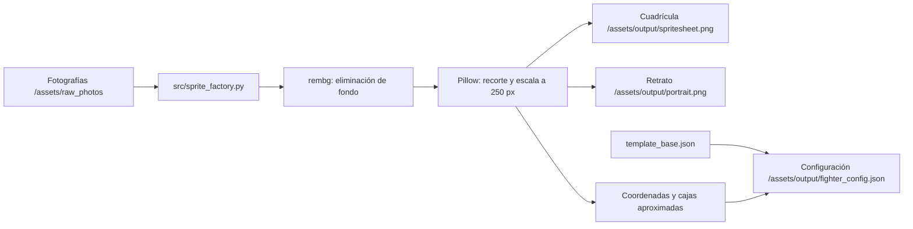

# Arquitectura técnica

## Objetivo

La fábrica procesa un lote de fotografías localmente y genera imágenes
normalizadas más una configuración JSON para un personaje de videojuego 2D.
El único punto de entrada y flujo de procesamiento se implementa en
`src/sprite_factory.py`.

## Stack tecnológico

| Componente | Uso |
|---|---|
| Python 3 | CLI, flujo de procesamiento y configuración |
| `rembg` / U²-Net | Segmentación del fondo y generación de transparencia |
| Pillow | Orientación EXIF, recorte, escala y composición de PNG |
| JSON | Plantilla de estadísticas y configuración generada |

Python y Pillow realizan la orquestación y manipulación de imágenes. `rembg`
ejecuta el modelo localmente; la primera ejecución descarga el modelo, pero las
fotografías no se envían a una API remota. La instalación probada es Windows con
Python 3.14.10. Se incluyen pasos para Fedora, aún pendientes de validación; otras
versiones de Python tampoco se han certificado.

## Flujo de procesamiento



Se admiten PNG, JPEG y WEBP; se recomienda una foto nítida, bien iluminada, de
cuerpo completo y con una sola persona visible. El nombre del archivo no es
obligatorio, pero se recomienda un prefijo numérico para indicar el orden, el
nombre de la acción y, en secuencias, un sufijo numérico para el cuadro:
`01_reposo.png`, `02_caminar_01.png`, `02_caminar_02.png` y
`05_golpe_activo_01.png`. Se quitan el prefijo y sufijo numéricos al agrupar
animaciones; las fases `golpe_*` se agrupan como `golpe`. Solo los nombres que
empiezan por `golpe_activo` o `golpe_impacto` reciben una hitbox estimada.
Se prefiere una pose `reposo` para el retrato; si falta, se usa la primera imagen
en orden alfabético. Después de corregir la orientación EXIF, eliminar fondo y
recortar transparencia, cada figura se escala a 250 píxeles de alto y se coloca
en una celda transparente. Hurtboxes y hitboxes son estimaciones, no anotaciones
manuales.

## Estructura

```text
assets/
  raw_photos/  Fotografías de entrada
  output/      Spritesheet, retrato y configuración generados
docs/          Documentación técnica
src/           Implementación principal
```
